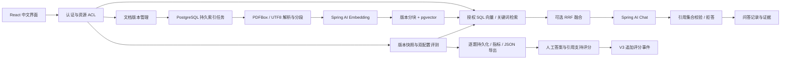

# 架构与工程取舍

CiteBase 是 Java 21 模块化单体，React 负责界面，Spring MVC 接口与后台索引worker共进程。JDBC明确执行所有权条件；Flyway控制迁移。Spring AI提供真实聊天与embedding调用。未引入微服务、消息队列、Python核心或Agent工具执行器。

## 模块与数据流

`AuthService`保存BCrypt密码与随机32字节令牌的SHA-256摘要，令牌12小时失效。每个Controller先认证，访问服务校验owner，检索SQL还在 WHERE 内限制 `knowledge_base.user_id` 和知识库ID。浏览器从不直接访问数据库或供应商密钥。

## 数据模型

`app_user → knowledge_base → document → document_version → chunk`；`index_task`绑定文档版本。`auth_session`绑定用户。`question_history`、`evaluation_run`同时绑定用户和知识库。文档删除依靠级联删除索引/任务/版本；对历史快照采取保守策略，清除整个所属知识库历史及评测，防止旧内容继续暴露。具体DDL见backend Flyway迁移。

阶段一新增 Flyway V3 的 `evaluation_score`，通过外键绑定评测记录，保存题号、检索模式、人工答案正确性、引用支持判断、错误分类、评分来源、依据、规则版本以及服务端确定的评分人和时间。评分采用追加事件，不更新 `evaluation_run.payload` 中的自动结果；删除评测时级联清除评分。数据库序列确定事件先后，GET/导出在原始自动结果上附加完整评分历史及逐题最新评分。

知识库上传通过行锁序列化去重。原文件以bytea保存；版本记录SHA-256及解析类型。按空行分段，页码/页内段落从1起，偏移为规范化换行后的页内Java字符偏移，左闭右开。长段落900字符窗口、700字符步长；未变内容+相同embedding模型复用向量。旧可用版本始终保留，全部新分块完成后才在短事务内原子切换 `active_version_id`。

任务领取使用 `FOR UPDATE SKIP LOCKED`，最多3次总尝试，固定3秒重试延时；启动恢复PROCESSING。第三次中断转FAILED；显式手动重试只允许最新失败版本。MVP为单后端实例，不可直接运行多个进程共享同库worker，因为启动恢复尚无跨实例租约协议。

## 检索与生成

精确pgvector余弦检索，不用ANN索引，维度由模型返回，适合小规模可解释实验。每条候选必须来自当前可用版本、请求用户的知识库且embedding模型一致。

关键词采用Latin词和中文相邻双字bigram，PostgreSQL simple tsvector+OR查询；混合将向量候选与关键词候选等权RRF融合，`sum(1/(60+rank))`，rank从1开始，各路候选max(20,4K)，最终TopK，K范围1–20。它不生成多查询，不是教程的多查询RAG Fusion。中文同义词、词边界和跨字匹配存在局限；不宣称完整中文语义分词。

文档以JSON证据放入user消息，安全规则放system消息；不提供工具、URL抓取或数据库调用能力。模型只能看到已授权证据。回答引用UUID必须在本次检索集合，未知/缺失/残缺引用拒绝；证据不足统一返回固定拒答。引用格式校验不是事实蕴含验证，提示注入防护也不是对任意模型的形式化保证，真实行为需安全用例实测。

## 一致性与评测

问答、评测使用知识库级 PostgreSQL advisory共享读锁，版本切换和删除使用独占写锁，避免进行中问答在删除后重新保存内容，同时允许问答与评测并发。评测主事务持锁获得稳定数据版本；运行状态与每题结果用REQUIRES_NEW短事务持久化。中断后保留已完成结果并标记FAILED，用户重新建评测；索引任务则自动恢复。代价是同知识库的写入/删除会等待评测，适合单人/小团队MVP。并发数据库测试验证了读读不阻塞、删除确实在pg_locks等待。

评测保留数据版本哈希、完整题集、模型标识、脱敏endpoint、分块和检索参数。问答计时使用单调时钟。目前保存的 `promptTokens`、`completionTokens` 仅来自聊天供应商实际返回的 usage，缺失时为 null；embedding 路径目前调用 `embed` 接口，尚未保留供应商 embedding usage。因此不能把聊天 token 之和称为全链路 token 或完整成本，也不得估算补齐 embedding 用量；该统计扩展留待后续阶段。没有把mock哈希向量、摘录回答或API故障伪装成真实模型效果。

## 阶段一：稳定标注与人工复核

评测入口使用显式 JSON schema 校验，拒绝未知字段、重复 JSON 字段、错误类型及尾随 JSON 内容，不依赖 Jackson 的宽松字段忽略或类型转换。题目可附带 category、split、group、topic，按维度输出逐配置统计。格式与接口见 [阶段一契约](API-CONTRACT-PHASE2.md)。

`EvaluationLabels` 只读取当前用户指定知识库的活动文档版本，通过 `DocumentParser` 重建页内段落原文；标签验证不局限于本次候选分块，跨分块的原文片段也可解析。标签以文档名、原始文件字节 SHA-256（sourceHash）、页码、段落、UTF-16 半开区间及 quote 定位。旧四字段标注可解析后补全；文档歧义、版本哈希不符、原文位置不存在或不唯一、跨用户/跨库标注均拒绝，并在创建评测及调用模型前结束校验。评测共享读锁保护活动版本，指标通过候选 versionId 对照本次 sourceHash 快照，避免旧版本相同文字误计命中。

同一非空 groupId 下的标签为可替代证据，任一命中即可；不同组必须分别命中，未指定 groupId 的每条标签为独立必需组。Recall@K 为命中组数除以总组数，MRR 为首个命中任意组的排名倒数；另记录命中组数及 allEvidenceHit，不能将“命中一组”当作“所需证据齐全”。候选命中仍要求标签原文范围完整包含在单个候选中，尚未实现多个候选拼接覆盖一个长标签的评分。

人工评分仅允许评测所属用户对已结束评测中的实际结果行提交，评分写入时锁定评测记录并重新检查归属与目标。来源固定为 human，依据和规则版本必填；引用支持可为 null，错误分类使用受控枚举。自动 `answerCorrect` 始终为 null，未人工评分时 `manualScore` 也为 null；引用格式有效、证据命中和参考短答案匹配均不自动推断答案正确或引用支持。此流程提供可追溯人工判断，不声称已完成全量人工评分。

## 局限

不含OCR、注册/密码管理、生产速率限制、SSO、多实例调度、异步流式答案。已提供逐题人工评分与审计，但未实现标注任务分发、多人独立复核、争议仲裁或标注者一致性统计；人工评分来源记录本身不保证判断正确。同步评测请求可长时间占用连接，Nginx超时30分钟；模型超时有上限。保留历史版本会占数据库空间，当前没有自动归档策略。训练/索引/运行均不需要外部Python服务。

## 阶段二检索扩展（真实实验已完成）

V4为每个文档版本保存`chunk_strategy/chunk_size/chunk_overlap`，为块保存`heading_path`。旧版本补全legacy 900/200，不重建、不更换embedding模型。上传或更新可以选structure-v1；具体段落/标题/表格边界、超长行限制、UTF-16位置约束见CHUNKING.md。配置不同即新版本，只有全部索引成功后切换；实际相同内容和embedding模型仍可复用已有向量。

`RetrievalOptions`使候选数、关键词RRF权重、专用reranker和引用风格可配置。单查询加权RRF为`1/(60+vectorRank) + keywordWeight/(60+keywordRank)`；不是多查询RAG Fusion。候选SQL始终带用户、知识库、当前活动版本和embedding模型条件。reranker只能接收已授权候选，供应商索引必须唯一、整数且在候选范围内；超时、限流和异常映射返回明确失败，不伪装为成功降级。

可选compact模式将本次证据UUID映射为E1…En供生成使用，再由代码严格映射回实际UUID并执行原引用校验。未知别名、混用UUID或残缺引用均拒绝。此机制只改善格式传输，不证明引用支持论断。诊断保存实际原始回答、别名映射、各路候选、阶段耗时及配置，不记录隐藏思维链。

阶段二补充实际embedding/reranker usage；无值保持null，供应商明确返回0才记录0，不通过总和估算缺失total。此前冻结基线未采集embedding usage的限制仍适用于历史记录。新增`/api/retrieval-diagnostics`是授权的纯检索入口，不能当作完整问答延迟。专用reranker使用独立RERANK_*配置，mock明确拒绝该真实调用，不消耗密钥。当前尚未改变上述单实例任务恢复和同步评测语义；这些是阶段四待办。

阶段二最终结果与冻结过程见EXPERIMENTS.md，664条真实实验保留。结构切分与重排在当前测试语料改善了检索指标，同时增加检索延迟和供应商用量；未据此更改通用默认，未人工评分的答案正确性仍为null。

## 阶段三 Agent（实现已集成，真实验收进行中）

基础RAG保持原路径。V5增加agent_run/agent_step，创建请求持久化幂等键、配置和数据快照；显式execute触发受限执行。Spring AI只产生单个工具请求，Java验证白名单参数、调用授权检索/邻段/引用检查，最终对积累证据执行原引用校验。工具证据进入状态之前再次核对数据库真实内容与所属范围。

AgentPolicy通过调用次数、证据数量/字符、输出长度、单调时钟deadline与进程并发上限约束执行。取消/源变更只保留安全计数和实际用量；删除沿用知识库级历史撤回策略。轨迹只保存行动、工具和证据，没有隐藏思维链。详见AGENT.md与API-CONTRACT-PHASE3.md。

当前Agent重启将不确定执行标记中断，不自动重放收费步骤；依然不是多实例任务治理。首轮真实开发冒烟4条因重复引用检查被NO_PROGRESS终止，失败保留并改进工具说明后再验收。真实对比尚未完成，不将MOCK界面通过算作模型能力。
