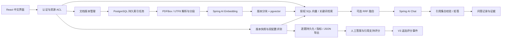

# 架构与工程取舍

CiteBase 是 Java 21 模块化单体，React 负责界面，Spring MVC 接口与后台索引worker共进程。JDBC明确执行所有权条件；Flyway控制迁移。Spring AI提供真实聊天与embedding调用。未引入微服务、消息队列或Python核心；Agent工具由Java白名单受控执行。

## 模块与数据流

`AuthService`保存BCrypt密码与随机32字节令牌的SHA-256摘要，令牌12小时失效。每个Controller先认证，访问服务校验owner，检索SQL还在 WHERE 内限制 `knowledge_base.user_id` 和知识库ID。浏览器从不直接访问数据库或供应商密钥。

## 数据模型

`app_user → knowledge_base → document → document_version → chunk`；`index_task`绑定文档版本。`auth_session`绑定用户。`question_history`、`evaluation_run`同时绑定用户和知识库。文档删除依靠级联删除索引/任务/版本；对历史快照采取保守策略，清除整个所属知识库历史及评测，防止旧内容继续暴露。具体DDL见backend Flyway迁移。

阶段一新增 Flyway V3 的 `evaluation_score`，通过外键绑定评测记录，保存题号、检索模式、人工答案正确性、引用支持判断、错误分类、评分来源、依据、规则版本以及服务端确定的评分人和时间。评分采用追加事件，不更新 `evaluation_run.payload` 中的自动结果；删除评测时级联清除评分。数据库序列确定事件先后，GET/导出在原始自动结果上附加完整评分历史及逐题最新评分。

知识库上传通过行锁序列化去重。原文件以bytea保存；版本记录SHA-256及解析类型。按空行分段，页码/页内段落从1起，偏移为规范化换行后的页内Java字符偏移，左闭右开。长段落900字符窗口、700字符步长；未变内容+相同embedding模型复用向量。旧可用版本始终保留，全部新分块完成后才在短事务内原子切换 `active_version_id`。

当前索引、评测和Agent使用统一 `work_task` 租约协议与 `FOR UPDATE SKIP LOCKED` 领取；不再启动时无条件恢复PROCESSING。重试上限和租约可配置，过期回收递增fencing token，所有发布检查当前租约。两个实际worker竞争与崩溃恢复已在上一阶段验证，详见TASKS.md。本段替换遗留MVP单实例描述；旧V5 worker仍不可与新版混跑。

## 检索与生成

精确pgvector余弦检索，不用ANN索引，维度由模型返回，适合小规模可解释实验。每条候选必须来自当前可用版本、请求用户的知识库且embedding模型一致。

关键词采用Latin词和中文相邻双字bigram，PostgreSQL simple tsvector+OR查询；混合将向量候选与关键词候选等权RRF融合，`sum(1/(60+rank))`，rank从1开始，各路候选max(20,4K)，最终TopK，K范围1–20。它不生成多查询，不是教程的多查询RAG Fusion。中文同义词、词边界和跨字匹配存在局限；不宣称完整中文语义分词。

文档以JSON证据放入user消息，安全规则放system消息；不提供工具、URL抓取或数据库调用能力。模型只能看到已授权证据。回答引用UUID必须在本次检索集合，未知/缺失/残缺引用拒绝；证据不足统一返回固定拒答。引用格式校验不是事实蕴含验证，提示注入防护也不是对任意模型的形式化保证，真实行为需安全用例实测。

## 一致性与评测

问答网络调用不持有数据库长事务；发布前在知识库共享锁下再次核验来源，删除/切换版本使用独占锁。评测创建保存文档版本快照与逐题记录，返回任务ID；检索SQL在用户/知识库范围内使用该快照的旧版本，因此版本更新不阻塞长评测。引用访问必须属于本次评测实际结果；文档删除级联撤回关联评测和Agent历史，旧引用不可继续访问。

统一work_task保存租约、owner、fencing token和重试代次，PostgreSQL时钟决定租约有效性；SKIP LOCKED领取，短事务发布，外部模型调用不持锁。INDEX分块stage、EVALUATION逐题item/attempt保存检查点；AGENT只有完整outcome可安全恢复发布，未完成执行明确失败。调用意图与返回实际用量分别持久，UNKNOWN保留供应商可能已经计费的崩溃窗口。详见TASKS.md。

记录聊天、embedding、reranker实际返回用量；缺失字段为null，历史未采集用量不补算。模型耗时用单调时钟，调度/租约用数据库时间。mock仅验证业务流程，不用于模型结论。

## 阶段一：稳定标注与人工复核

评测入口使用显式 JSON schema 校验，拒绝未知字段、重复 JSON 字段、错误类型及尾随 JSON 内容，不依赖 Jackson 的宽松字段忽略或类型转换。题目可附带 category、split、group、topic，按维度输出逐配置统计。格式与接口见 [阶段一契约](API-CONTRACT-PHASE2.md)。

`EvaluationLabels` 只读取当前用户指定知识库的活动文档版本，通过 `DocumentParser` 重建页内段落原文；标签验证不局限于本次候选分块，跨分块的原文片段也可解析。标签以文档名、原始文件字节 SHA-256（sourceHash）、页码、段落、UTF-16 半开区间及 quote 定位。旧四字段标注可解析后补全；文档歧义、版本哈希不符、原文位置不存在或不唯一、跨用户/跨库标注均拒绝，并在创建评测及调用模型前结束校验。评测创建用短共享锁冻结版本，随后使用持久快照检索；指标通过候选versionId对照sourceHash，避免非本次版本的相同文字误计命中。

同一非空 groupId 下的标签为可替代证据，任一命中即可；不同组必须分别命中，未指定 groupId 的每条标签为独立必需组。Recall@K 为命中组数除以总组数，MRR 为首个命中任意组的排名倒数；另记录命中组数及 allEvidenceHit，不能将“命中一组”当作“所需证据齐全”。候选命中仍要求标签原文范围完整包含在单个候选中，尚未实现多个候选拼接覆盖一个长标签的评分。

人工评分仅允许评测所属用户对已结束评测中的实际结果行提交，评分写入时锁定评测记录并重新检查归属与目标。来源固定为 human，依据和规则版本必填；引用支持可为 null，错误分类使用受控枚举。自动 `answerCorrect` 始终为 null，未人工评分时 `manualScore` 也为 null；引用格式有效、证据命中和参考短答案匹配均不自动推断答案正确或引用支持。此流程提供可追溯人工判断，不声称已完成全量人工评分。

## 局限

不含OCR、注册/密码管理、生产速率限制、SSO、异步流式答案。已提供逐题评分与审计，第三阶段另提供盲评任务分配、独立复核、争议仲裁与一致性统计；目前真人评审尚未完成，账户记录也不能证明操作者为真人或判断正确。评测与Agent通过轮询任务状态；在途HTTP取消为尽力而为，不能撤销供应商计费。保留历史版本会占数据库空间，当前没有自动归档策略。训练/索引/运行均不需要外部Python服务。

## 阶段二检索扩展（真实实验已完成）

V4为每个文档版本保存`chunk_strategy/chunk_size/chunk_overlap`，为块保存`heading_path`。旧版本补全legacy 900/200，不重建、不更换embedding模型。上传或更新可以选structure-v1；具体段落/标题/表格边界、超长行限制、UTF-16位置约束见CHUNKING.md。配置不同即新版本，只有全部索引成功后切换；实际相同内容和embedding模型仍可复用已有向量。

`RetrievalOptions`使候选数、关键词RRF权重、专用reranker和引用风格可配置。单查询加权RRF为`1/(60+vectorRank) + keywordWeight/(60+keywordRank)`；不是多查询RAG Fusion。候选SQL始终带用户、知识库、当前活动版本和embedding模型条件。reranker只能接收已授权候选，供应商索引必须唯一、整数且在候选范围内；超时、限流和异常映射返回明确失败，不伪装为成功降级。

可选compact模式将本次证据UUID映射为E1…En供生成使用，再由代码严格映射回实际UUID并执行原引用校验。未知别名、混用UUID或残缺引用均拒绝。此机制只改善格式传输，不证明引用支持论断。诊断保存实际原始回答、别名映射、各路候选、阶段耗时及配置，不记录隐藏思维链。

阶段二补充实际embedding/reranker usage；无值保持null，供应商明确返回0才记录0，不通过总和估算缺失total。此前冻结基线未采集embedding usage的限制仍适用于历史记录。新增`/api/retrieval-diagnostics`是授权的纯检索入口，不能当作完整问答延迟。专用reranker使用独立RERANK_*配置，mock明确拒绝该真实调用，不消耗密钥。阶段四已将索引、评测和Agent接入统一租约任务，实际多进程验收进度见PROGRESS。

阶段二最终结果与冻结过程见EXPERIMENTS.md，664条真实实验保留。结构切分与重排在当前测试语料改善了检索指标，同时增加检索延迟和供应商用量；未据此更改通用默认，未人工评分的答案正确性仍为null。

## 阶段三 Agent（冻结真实对照已完成）

基础RAG保持原路径。V5增加agent_run/agent_step，创建请求持久化幂等键、配置和数据快照；显式execute触发受限执行。Spring AI只产生单个工具请求，Java验证白名单参数、调用授权检索/邻段/引用检查，最终对积累证据执行原引用校验。工具证据进入状态之前再次核对数据库真实内容与所属范围。

AgentPolicy通过调用次数、证据数量/字符、输出长度、单调时钟deadline与进程并发上限约束执行。取消/源变更只保留安全计数和实际用量；删除沿用知识库级历史撤回策略。轨迹只保存行动、工具和证据，没有隐藏思维链。详见AGENT.md与API-CONTRACT-PHASE3.md。

Agent依靠任务租约避免多实例重复领取；无法安全恢复的执行不自动重放收费步骤。冻结真实对照和供应商恢复补测已完成，原150次尝试全部保留，Agent未显示收益，不替代基础RAG。首轮失败、配置冻结、补测的组合统计限制见EXPERIMENTS。

## 第三阶段开发：检索成本与运维（辅助评审续开发）

本节描述当前代码；不把前文第二阶段的历史实验等同于第三阶段验收。真人盲评仍未发生，用户已授权独立标识的辅助评审继续。双JVM/真实PG的13项故障检查和794次明确mock混合负载已通过；生成策略真实独立实验已完成，候选失败门槛未通过。新成本开关默认关闭，不据自动指标宣称答案质量非劣或修改通用默认。

`RetrievalOptions` 新增可选 `rerankPolicy/deduplicate/cache`，旧四字段请求保持兼容。`candidate-pressure-v1` 仅在开启 rerank 且候选代表数大于 topK 时调用专用重排；它是候选数量规则，不是模型对证据充分性的判断。候选去重只合并完全相同正文作为供应商输入，保存代表→所有来源块映射；重排结果按来源组展开再截断 topK。它不删除原始授权来源，也不是语义近重复检测。

`RetrievalCache` 是进程内、同步访问的 LRU/TTL 缓存，默认最多128项、TTL300秒、序列化内容上限8000000字节；参数为 `RETRIEVAL_CACHE_MAX_ENTRIES/TTL_SECONDS/MAX_BYTES`。键包含用户、知识库、活动版本集合或评测快照、原始查询、检索模式、topK、实际候选数量、选项及模型/供应商配置。仅缓存成功的检索结果，不缓存生成答案或失败；多个 worker 不共享缓存，也没有并发相同请求合并保证。

缓存命中仍在知识库共享锁下重新检查所有权、来源版本及实际候选的标识/名称/位置/正文；不仅检查最终topK，也校验诊断中的向量、关键词及融合候选。评测缓存继续绑定其冻结快照，不能借命中扩大权限或继续读取已删除内容。失效条目可能暂留进程内存直至TTL/LRU淘汰，但访问时数据库校验失败即移除并拒绝返回。命中记录当前 embedding/rerank 调用数为0、实际usage为null且原因 `not_called_cache_hit`，不把首次调用用量重复算成当前调用；生成仍沿原路径执行。

运维有两种明确作用域：普通 Bearer 用户的 `/api/operations/summary` 在每个聚合SQL内先按本人过滤；`/api/operations/local` 只接受独立 `OPERATIONS_TOKEN`，读取本 JVM 的资源与任务/连接池指标，普通用户令牌不授权跨租户实例汇总。后者token至少32字符，应由受限运维客户端持有，不放前端配置。V10 `work_task_event` 记录已提交的任务转移、租约回收与未知调用事件，不回填历史；任务删除时级联撤回。

`TaskWorker` 的执行计时按尝试 outcome 区分成功、延期、取消、重试等待、租约丢失和持久化不可用；fence拒绝计数直接记录尝试，不因事务回滚消失。领取数据库失败退避5秒，固定无敏感正文的警告每实例30秒至多一次。liveness只反映进程状态，readiness另检查数据库；连接获取上限2.5秒、SQL查询上限2秒，探测不调用模型。详见 [运维契约](API-CONTRACT-OPERATIONS.md) 与 [任务说明](TASKS.md)。

第三阶段准入补充：AdmissionService在任务创建事务内通过PostgreSQL advisory事务锁串行核对全局/用户非终态容量（默认256/64），幂等重放先返回旧任务，容量拒绝回滚创建。QUEUED/RUNNING/RETRY_WAIT/CANCEL_REQUESTED均占用容量，终态释放；所有实例须配置一致。同步RAG/诊断在授权核验后使用每JVM有界信号量（默认4），finally释放，拒绝HTTP429并返回Retry-After（默认3秒）；没有全局供应商QPS保证，前端手动重试并保留输入。实际双JVM准入证据见LOAD_TESTING。冻结成本实验240行/288辅助评分完成，候选未证明质量可接受，默认不变，见COST_INDEPENDENT_RESULTS。
